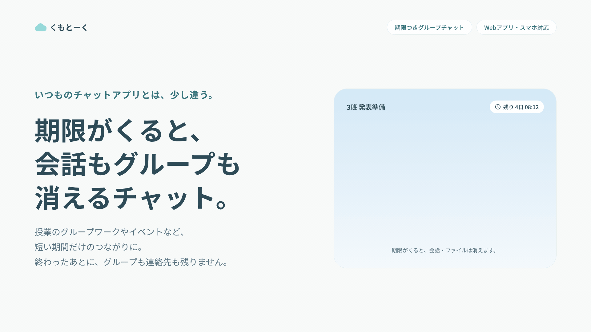
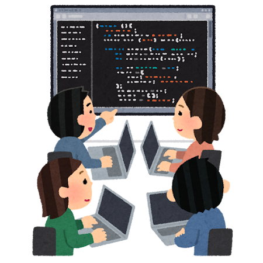
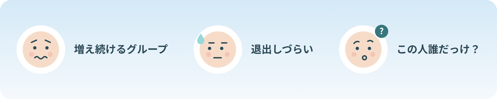
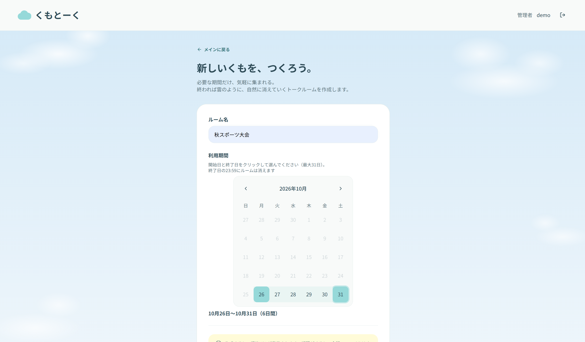
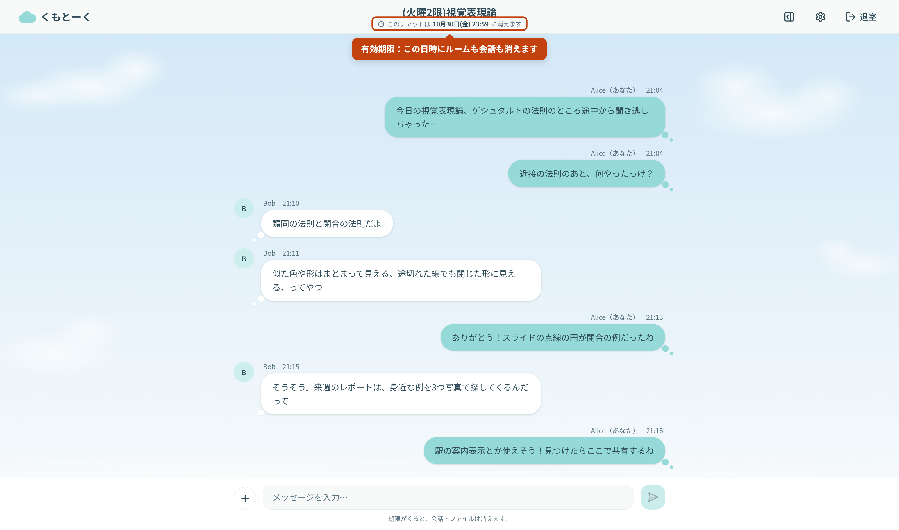
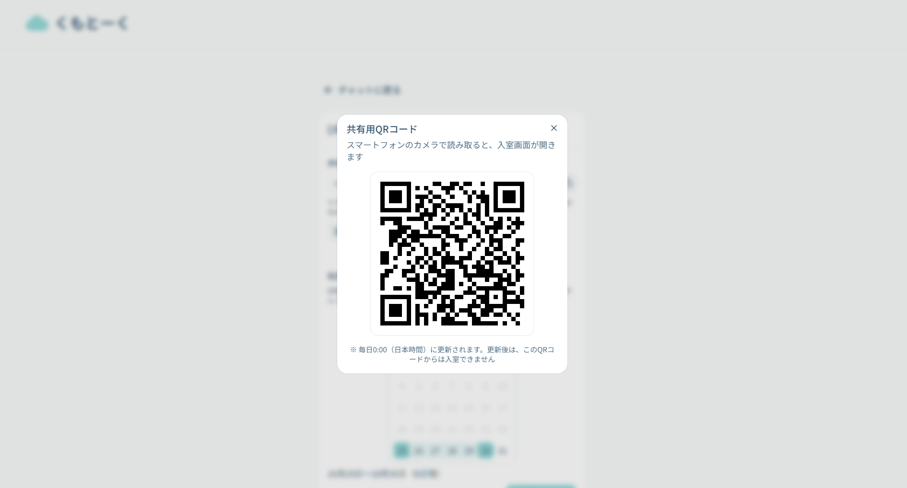
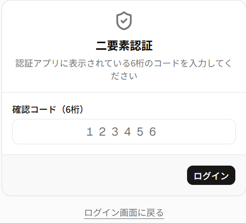
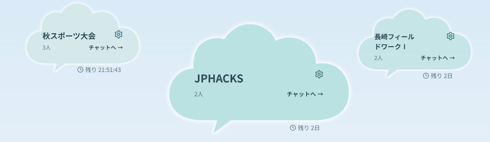

# チャットアプリ「くもとーく」

<!-- メインとなる画像に差し替える予定 -->
<!--

-->
<!--  -->

## 製品概要

<!-- 動画を挿入予定 -->

### コミュニケーション × Tech

  <!-- 
  
  
   
  -->
  
  

### 背景(製品開発のきっかけ、課題等)

大学の授業では、グループワークや課題のために、その場限りのメンバーで連絡を取り合う機会が多くあります。そのたびに**一時的なグループLINEを作成しますが、2週間ほどで必要なくなってしまう**ことがほとんどです。

課題が終わり、授業の学期が終われば、トークや写真を見返すこともありません。それでもメンバーとは絶妙な距離感のため、退出すれば「退出しました」というログが残り、グループを削除するのもどこか気まずく、結局そのまま放置してしまいます。そうしているうちに**似たようなグループLINEが増え続け、本当に必要なグループを探すときの邪魔に**なります。
さらに、その一瞬の連絡のためだけに友だち追加をするので、友だち一覧には個人のトーク履歴もない、**「この人誰だっけ？」という連絡先**も増えていきます。

こうした経験から、私たちは「**短期間しか必要のないグループのために、グループやメッセージ、連絡先がいつまでも残り続けてしまう**」ことを課題としました。
そこで、**あらかじめ決めた期間が過ぎると、メッセージもグループも消え去る**コミュニケーションツールを開発しました。

### 製品説明（具体的な製品の説明）

本製品は、**期限付きで消えるグループチャット** の **Webアプリ** です。

- 授業のグループワークやサークル・部活のイベントなど、短い期間だけ連絡を取り合いたいグループのためのチャットツール

- ルームの作成時に利用期間（最大31日）を日付で決めると、期間が過ぎたときにメッセージもルームも自動で消えます。

- 参加者はアカウント登録が不要です。共有URLかQRコードを開き、ニックネームを入力するだけでトークに参加できます。

### 特長

#### 1. 期間が来たら、メッセージもグループもすべて消える

- **予定に合わせて、日付で利用期間を決める**

ルームの作成時に、カレンダーから「10月26日〜11月9日」のように利用期間を選びます（最大31日）。
課題の締切や部活の大会など、予定ありきで使う場面を想定し、時間ではなく日付で決められるようにしました。
終了日の23:59になると、ルームもメッセージも自動で消えます。退出や削除の操作がいらないので、気まずさもありません。

<!-- 仮の画像: ルーム作成画面（カレンダーで利用期間を選ぶところ） -->

  

- **そもそも残さない設計**

メッセージはデータベースに保存せず、インメモリデータベースの **Redis に有効期限（TTL）付きで保持**しています。
期限が来るとRedisがデータを自動で削除するため、「画面からは見えないが、サーバーには残っている」という状態になりません。

- **消滅までのカウントダウン**

チャット画面には、ルームが消えるまでの残り時間を表示します。あとどれくらい会話できるのかが一目でわかります。

<!-- 画像: チャット画面（カウントダウン） -->

#### 2. アカウント登録なしで、QRコードからすぐ参加できる

- **参加者は登録不要**

管理者から共有されたURLを開き、ニックネームを入力するだけでトークに参加できます。
メールアドレスやパスワードの登録、友だち追加は必要ありません。一時的なグループのために連絡先を交換しなくてよいので、「この人誰だっけ？」という連絡先も増えません。

<!-- 画像: 入室画面（ニックネームの入力） -->

- **QRコードで、その場にいるメンバーにすぐ共有**

ルームを作成すると、共有用URLと一緒にQRコードを表示します。
授業や部活の集まりなど、その場にいるメンバーにはスマートフォンで読み取ってもらうだけで参加してもらえます。

  

- **登録なしでも、なりすましはできない**

参加者は Supabase の匿名認証で一時的なユーザーとして扱っています。
個人情報を一切預からずに、サーバー側で「誰がどのルームのメンバーか」を確認できるため、他人になりすましての投稿はできません。

#### 3. 共有URLが広まっても、参加され続けない

- **共有URLは毎日0:00に自動で更新**

参加用パスワードの入力をなくした代わりに、共有URLを毎日0:00に新しいものへ切り替えます。
古いURLやQRコードからは入室できなくなるため、URLが意図せず転送されても、無期限に参加され続けることはありません。
すでに入室しているメンバーは、URLが更新されてもそのまま会話を続けられます。

- **招待URLはハッシュ値だけを保存**

サーバーには招待URLのトークンそのものではなく、ハッシュ値だけを保存しています。万が一データが漏れても、そこから有効な招待URLを復元することはできません。

- **ルームを作れるのは、二要素認証でログインした管理者だけ**

ルームの作成や設定の変更ができるのは、パスワードと認証アプリ（TOTP）の二要素認証でログインした管理者だけです。

<!-- 仮の画像（写真が多ければ削除予定）: 管理者ログインの二要素認証画面 -->

  

### 解決出来ること

- 使い終わったグループが溜まらない
  - 決めた期間が過ぎると、グループもメッセージも自動で消えます。
  - 似たようなグループが増え続けないので、本当に必要なグループを探しやすくなります。

- 退出や削除の気まずさをなくす
  - 誰かが退出や削除の操作をしなくても、グループは期限が来れば自然に消えます。
  - 「退出しました」というログが残ることもありません。

- その場限りの連絡先が増えない
  - 友だち追加をせず、共有URLやQRコードからニックネームだけで参加できます。
  - 一瞬の連絡のためだけの「この人誰だっけ？」という連絡先が増えません。

### 今後の展望

- トーク内で投票を行い、日程調整や役割分担をその場で決められるようにする
- ルームと一緒に消える共有メモ「消えるノート」を追加する
- 共有URLが漏れたときに、0:00を待たずに管理者がすぐ新しいURLに更新できるようにする
- ルームが消える前に「あと1日で消えます」と参加者へお知らせする
- スクリーンショットの撮影を検知して、参加者に警告を表示する

### 注力したこと（こだわり等）

- **話の盛り上がりに応じてチャットルームの雲の大きさが変わる**
  - メッセージが1件届くたびに点数が1増え、30分ごとに半分に減っていく設計
  - いま話が盛り上がっているルームほど雲が大きくなり、静かになると少しずつ小さくなります。
  - 視覚的に、見逃したくないトークを追うことができます。
 　　 
    
- **利用者の手間を最低限減らすように設計**
  - 当初はルーム作成時に、参加人数や参加用パスワードなどを細かく設定する方針を取っていましたが、「利用する手間」が「このアプリを利用する目的」を上回らないように方向性を定めました。
  - チャット作成時（ホスト）：「ルーム名」と「利用期限」のみの2ステップで作成完了。
  - チャット参加時：「ユーザ名」の入力だけでルームに参加可能。

## 開発技術

### 活用した技術

#### 使用言語

- TypeScript
- HTML / CSS
- SQL（PostgreSQL）

#### API・データ

- 外部サービス
  - [Supabase](https://supabase.com/)
    - Supabase Auth（管理者のログイン・二要素認証、ゲストの匿名認証）
    - Supabase Database（PostgreSQL。Row Level Security でルームごとの権限を管理）
  - [Upstash Redis](https://upstash.com/)（メッセージを有効期限付きで保持）
  - [Vercel](https://vercel.com/)（デプロイ）

#### フレームワーク・ライブラリ・モジュール

- [Git](https://git-scm.com/) / [GitHub](https://github.com/)
- [Next.js](https://nextjs.org/)（App Router）
- [React](https://react.dev/)
- [Tailwind CSS](https://tailwindcss.com/)
- [shadcn/ui](https://ui.shadcn.com/)
- [Base UI](https://base-ui.com/)
- [React DayPicker](https://daypicker.dev/)（利用期間を選ぶカレンダー）
- [qrcode.react](https://github.com/zpao/qrcode.react)（共有用QRコード）
- [Lucide](https://lucide.dev/)（アイコン）

### 独自技術

#### ハッカソンで開発した独自機能・技術

- 独自で開発したものの内容をこちらに記載してください
- 特に力を入れた部分をファイルリンク、またはcommit_idを記載してください。
