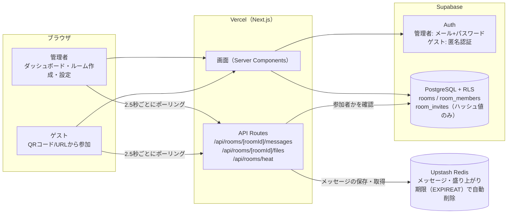
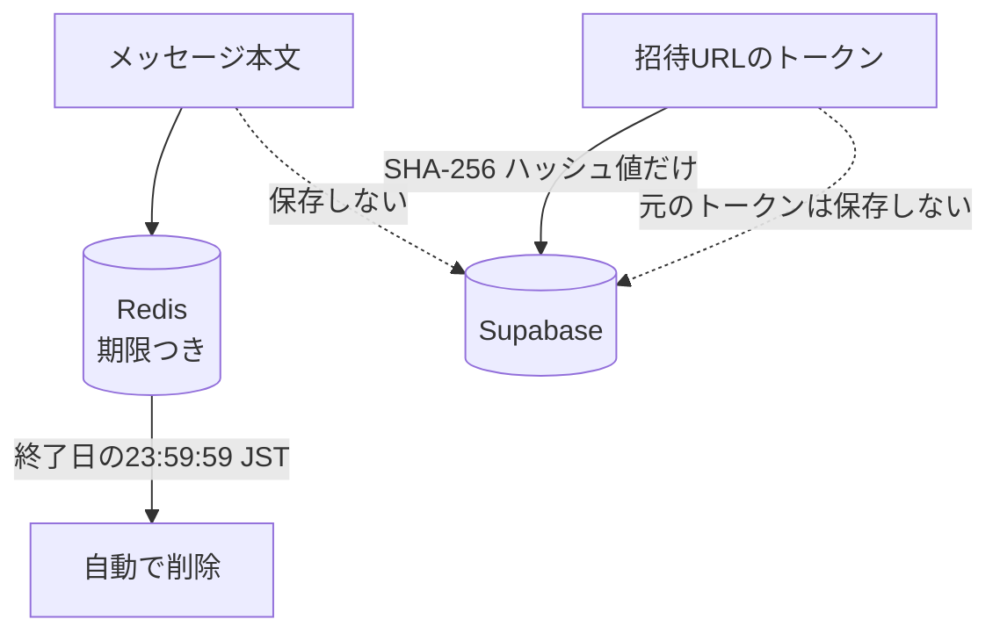
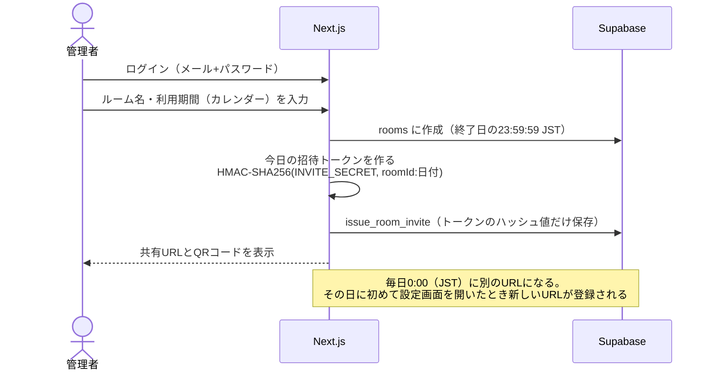
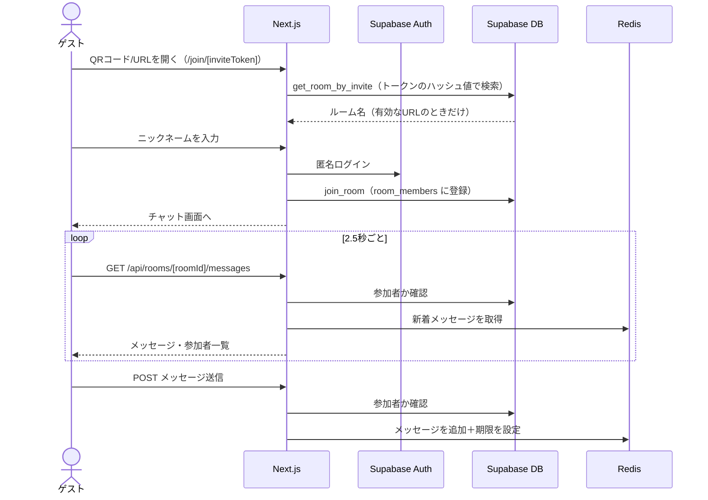
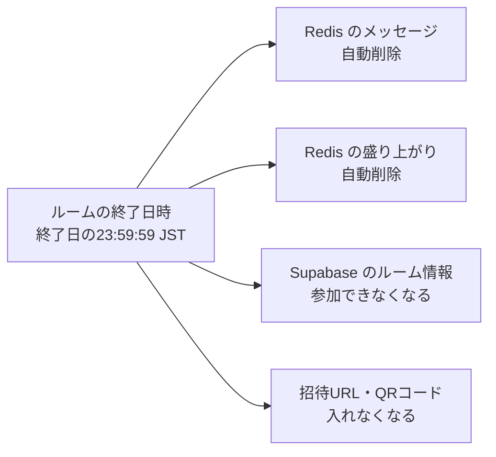
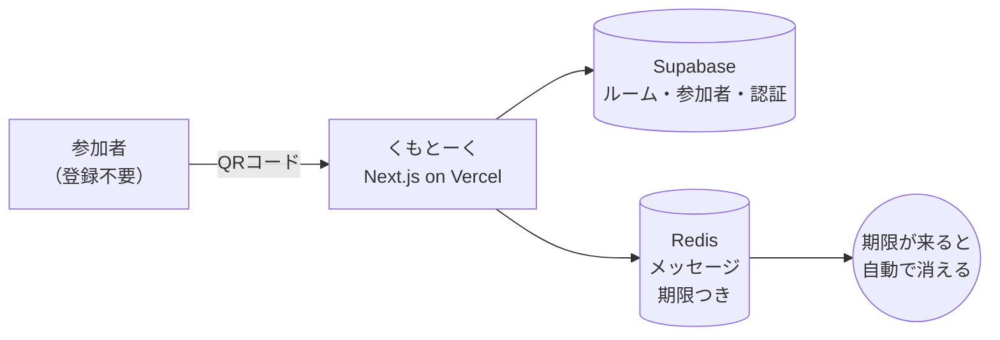

# くもとーく アーキテクチャ図（Mermaid）

発表資料・README・動画に載せる図の元になる内容。GitHub 上ではそのまま図として表示される。
別のツール（draw.io など）で描き直すときも、ここに書いた「何をつなぐか」を元にする。

> 実装の確認元: `src/app/api/rooms/`、`src/lib/redis-messages.ts`、`src/lib/invite.ts`、`src/app/(guest)/join/`、`src/app/rooms/[roomId]/page.tsx`

---

## 1. 全体構成（どこに何を置くか）

一番伝えたいこと: **メッセージは Redis にだけ置き、期限が来ると自動で消える**。Supabase にはメッセージを保存しない。

---

## 2. データの置き場所（「そもそも残さない」設計）

| 保存先 | 置くもの | 消え方 |
|---|---|---|
| **Upstash Redis** | メッセージ（`chat:room:{roomId}:messages`）、会話の盛り上がり（`chat:room:{roomId}:heat`） | ルームの終了日時（23:59:59 JST）に Redis が自動で削除 |
| **Supabase（PostgreSQL）** | ルーム情報、参加者（ニックネーム）、招待URLの**ハッシュ値** | 期限切れのルームは `purge_expired_rooms` で削除（※現在は定期実行を設定していない） |
| **サーバーのメモリ** | 共有ファイルの中身（開発用ストア） | サーバーの再起動で消える（保存先は未決） |

---

## 3. 管理者がルームを作って共有する流れ

---

## 4. ゲストが参加して会話する流れ

ゲストはアカウント登録不要だが、匿名認証で一時ユーザーになるので、**サーバー側で「誰がどのルームの参加者か」を確認できる**（なりすまし防止）。

---

## 5. 期限が来たときに消えるもの

---

## 6. 発表用に絞った1枚（簡略版）

細部を省いて、「何が・どこにあって・どう消えるか」だけを描いたもの。スライドや動画に載せるならこれ。

