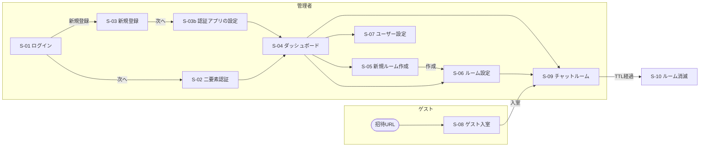

# 要件定義書

> 使い捨てチャットサービス（仮称）
> 最終更新: 2026-10-24

---

## 1. サービス概要

### 1.1 コンセプト

使い捨てチャットサービス [void](https://avoid.chat/) と、LINE / Slack の **中間** に位置するチャットサービス。

| | void | 本サービス | LINE / Slack |
|---|---|---|---|
| ログイン | 不要 | **管理者のみ必須** / メンバーはゲスト | 全員必須 |
| データ保存 | 残らない | **TTL経過で自動消滅** | 永続 |
| グループ管理 | なし | **管理者が利用期間（日付）を設定し、招待URLを定期的に更新** | 恒久的なグループ |

「残さないこと」をセキュリティ上の価値とし、メッセージはRDBに永続化せず、**メモリ（Redis）にのみTTL付きで保持**する。

### 1.2 想定シーン

イベントや部活の試合など、**予定（日付）ありきでトークルームを作る** 場面を主に想定する。

| 対象 | ユースケース |
|---|---|
| 家族 | 誕生日のサプライズ計画、旅行の計画（本人に見られず、終わったら消える） |
| 学生 | ハッカソンなど短期イベント、部活の試合・遠征（LINEグループが増え続けるのを避けたい） |
| 企業 | 一時的なパスワードや機密情報の共有 |

### 1.3 参加方式の考え方

- **ゲストの負担をなくす**: 参加用パスワードは設けない。招待URLを開いてニックネームを入れるだけで参加できる
- **URLの使い回しを防ぐ**: 招待URLは毎日0:00（JST）に自動更新し、古いURLからは入れなくする。不用意に共有されても、無期限に参加され続けることはない
- **期間は日付で決める**: 予定に合わせて「x月y日〜x月z日」の日付範囲でルームの利用期間を設定する

### 1.4 ユーザー種別

| 種別 | 説明 | 認証 |
|---|---|---|
| 管理者（Admin） | ルームを作成・設定する人 | **ログイン必須**（Supabase Auth + 認証アプリによる二要素認証） |
| ゲスト（Guest） | 招待URLから参加するメンバー | ログイン不要。有効な招待URLを開き、ニックネームを入力して入室 |

---

## 2. 技術スタック

| 領域 | 採用技術 | 備考 |
|---|---|---|
| フロントエンド | Next.js (App Router) + Tailwind CSS + shadcn/ui | Next.js 16系。`node_modules/next/dist/docs/` を参照のこと |
| リアルタイム通信 | Supabase Realtime **または** Pusher Channels | **未決定**（[8. 未決事項](#8-未決事項)参照） |
| TTL付きデータ保持 | Upstash Redis | メッセージ・ルーム情報はすべてここ |
| 認証 / 管理者情報 | Supabase (Auth) | 管理者アカウントのみ |
| アニメーション | Framer Motion | カウントダウン演出など |
| インフラ | Vercel | デプロイ |

### 2.1 技術選定理由

- **Redis（永続化しない）**: 「永続化しないこと」自体がセキュリティ価値。最初からRDBに保存せず、TTL付きでRedisにのみ保持する設計が最もシンプルかつ安全。TTL経過でRedisが自動的にデータを削除するため、削除処理の実装漏れが起きない。
- **ゲストはログイン不要**: 審査員やユーザーが即座に体験できるよう、ゲストはCookie / LocalStorage に「ニックネーム」と「一時ユーザーID」を保存する方式とする（ハッカソンで有効）。
- **管理者のみログイン**: ルームの作成・設定変更の権限を守るため、管理者だけはSupabaseでログインさせる。
- **Framer Motion**: ルーム消滅までの視覚的なカウントダウン演出。

---

## 3. 画面一覧

モック画像は [docs/mock/](docs/mock/) に保存。

> **注意**: 02（ルーム設定）・03（新規ルーム作成）・05（ゲスト入室）のモックには、参加用パスワード・参加人数・日/時間/分のスピナーが描かれているが、**現在の要件では廃止**している。画面要件は「4. 画面別要件」を正とする。

| No | 画面名 | 利用者 | パス（案） | モック |
|---|---|---|---|---|
| S-01 | ログイン | 管理者 | `/login` | [01_login_signup.jpg](docs/mock/01_login_signup.jpg) |
| S-02 | 二要素認証 | 管理者 | `/login/verify` | （未作成） |
| S-03 | 新規登録 | 管理者 | `/signup` | [01_login_signup.jpg](docs/mock/01_login_signup.jpg) |
| S-03b | 認証アプリの設定 | 管理者 | `/signup/totp` | （未作成） |
| S-04 | ダッシュボード（ルーム一覧） | 管理者 | `/dashboard` | [06_admin_roomview.jpg](docs/mock/06_admin_roomview.jpg) |
| S-05 | 新規ルーム作成 | 管理者 | `/rooms/new` | [03_room_create.jpg](docs/mock/03_room_create.jpg) |
| S-06 | ルーム設定（管理者設定） | 管理者 | `/rooms/[roomId]/settings` | [02_room_settings.jpg](docs/mock/02_room_settings.jpg) |
| S-07 | ユーザー設定 | 管理者 | `/settings` | [04_user_settings.jpg](docs/mock/04_user_settings.jpg) |
| S-08 | ゲスト入室 | ゲスト | `/join/[inviteToken]` | [05_guest_join.jpg](docs/mock/05_guest_join.jpg) |
| S-09 | チャットルーム | 管理者・ゲスト | `/rooms/[roomId]` | [07_chat.jpg](docs/mock/07_chat.jpg) |
| S-10 | ルーム消滅 / URL期限切れ | 全員 | — | （未作成） |

### 3.1 画面遷移

---

## 4. 画面別要件

### S-01 ログイン（管理者）

- 入力: **メールアドレス**、**パスワード**
- 「次へ」ボタン → S-02 二要素認証へ
- 「新規登録」リンク → S-03

### S-02 二要素認証（管理者）

- 方式は **認証アプリ（TOTP）** による二要素認証（パスワード＝知識 ＋ スマホ＝所持）
- 認証アプリに表示された6桁のコードを入力
- 認証成功でダッシュボードへ

### S-03 新規登録（管理者）

- 入力: **メールアドレス**、**パスワード**、**パスワード（確認）**
- パスワードは **8文字以上で、英字と数字を両方含む**
- 登録情報はSupabaseに保存
- 「次へ」→ 認証アプリの設定画面（`/signup/totp`）でQRコードを読み取り、6桁のコードを入力して登録を完了する

### S-04 ダッシュボード（ルーム一覧 / 管理者）

- 画面名は「メイン（チャンネル）」。自分が作成した有効なルームを一覧表示する
- 各ルームは **雲（吹き出し）型のカード** で表示（例:「誕生日」「パスワード共有」）
  - カードにはルーム名と **タイマー（残り時間 / TTL）** を表示
- ヘッダー
  - **歯車アイコン** → 設定（ユーザー設定 / ルーム設定）
  - **「ルーム追加」ボタン** → S-05 新規ルーム作成
- 管理者はここからチャンネル追加、設定（時間設定など）を行う。ルーム設定は作成後でも変更可能
- カードをクリック → S-09 チャットルーム

### S-05 新規ルーム作成（管理者）

| 項目 | 入力形式 | 備考 |
|---|---|---|
| ルーム名 | テキスト | 必須 |
| 利用期間 | カレンダー（shadcn/ui Calendar の範囲選択）で日付範囲を選択（「x月y日〜x月z日」） | **日単位**。開始日は今日以降（先の日付の上限はなし）。期間は開始日・終了日を含めて **最大31日** |

- 参加人数の設定はない（人数制限なし）
- 参加用パスワードの設定はない
- 「作成」ボタンでルームを作成し、**終了日の終わり（23:59:59 JST）** に消えるようTTLを設定する
- 作成後は **共有用URLをダイアログで表示** する（コピーボタン付き、「※ 毎日0:00に更新されます」と注記）。「閉じる」で作成したルームのチャット画面（S-09）へ進む
- 期間のルール（最大31日・終了日の23:59:59に消える）は `src/lib/room-period.ts` にまとめ、ルーム設定やチャット画面の期限延長でも同じものを使う

### S-06 ルーム設定（管理者）

タイトル: 「〇〇のトークルーム〈設定〉」

| 項目 | 内容 |
|---|---|
| 共有URL | 今日の招待URL（`https://…/join/[inviteToken]`）を表示。コピーボタン付き。**毎日0:00（JST）に自動更新** され、更新後は前のURLからは入れない |
| QRコード | 「QRコードを表示」ボタンでポップアップ表示。閉じるのは×ボタンとEscキーのみ（読み取り中に誤って閉じないよう、外側のクリックでは閉じない） |
| 利用期間 | カレンダーで「x月y日〜x月z日」を変更可（日単位、開始日から最大31日）。**開始前のルームは開始日・終了日とも変更可、開始済みのルームは終了日のみ変更可** |

- パス: `/rooms/[roomId]/settings`。開けるのはルームの作成者だけ（未ログインは `/login` へ、それ以外は404）

- 参加人数の設定はない
- 参加用パスワードがないため、その変更設定もない
- URLが更新されても、**すでに入室済みのメンバーはそのまま参加を続けられる**（入れなくなるのは新規の入室のみ）

### S-07 ユーザー設定（管理者）

- **ID変更**: 現在のIDを表示し、新しいIDを入力
- **パスワード変更**: 「現在のパスワード」「新しいパスワード」を入力
- 「パスワードを忘れてしまった場合」リンク → パスワードリセット（メール送信）

### S-08 ゲスト入室

- 共有されたURLからアクセス
- 見出し: 「〇〇のトークルームに入室します」
- 入力: **ニックネーム** のみ（参加用パスワードは入力しない。現在有効な招待URLを知っていることを参加資格とする）
- 「入室」ボタン → S-09 チャットルーム
- 入室時に一時ユーザーIDを発行し、ニックネームとともに Cookie / LocalStorage に保存
- エラー表示: URL期限切れ（更新済みの古いURL） / ルーム消滅

### S-09 チャットルーム

レイアウト（モックより）:

| 領域 | 内容 |
|---|---|
| 左上 | **戻るボタン（←）** → 管理者はS-04、ゲストは退室確認 |
| 左サイドバー | **参加者一覧**（候補。採用するか未決） |
| メイン上部 | **制限時間（例: `0:00`）** ＝ ルーム消滅までのカウントダウン（Framer Motionで演出） |
| メイン | メッセージ一覧。**自分は右側**、他の参加者は左側に、アイコン（丸）＋吹き出しで表示 |
| 下部 | メッセージ入力欄と **「＋」ボタン**。＋を押すとメニュー（「消えるノート」「ファイル共有」）を表示 |

機能:

- メッセージの送受信（リアルタイム）
- **消えるノート**: ルーム内で共有するメモ（ルームとともに消える）
- **ファイル共有**: ファイルを共有（ルームとともに消える）
- 管理者には設定画面への導線を表示
- TTLが0になったら全員を S-10 へ遷移させる
- タイマーの表示単位（日単位か、時間・秒単位か）は未決（Q-04）

---

## 5. 機能要件

### 5.1 必須機能（MVP）

| ID | 機能 | 説明 |
|---|---|---|
| F-01 | 管理者登録・ログイン | Supabase Auth。メールアドレス + パスワード |
| F-02 | 二要素認証 | 認証アプリ（TOTP）。Supabase標準のMFA |
| F-03 | 管理者情報変更 | ID・パスワード変更、パスワードリセット |
| F-04 | ルーム作成 | ルーム名と利用期間（日付範囲）を設定 |
| F-05 | ルーム設定変更 | 利用期間（日付範囲）の変更 |
| F-06 | 招待URLの自動更新 | 毎日0:00（JST）に招待トークンを自動更新。古いトークンでは入室不可 |
| F-07 | ゲスト入室 | 有効な招待URL + ニックネームで入室。人数制限なし |
| F-08 | リアルタイムチャット | メッセージ送受信 |
| F-09 | TTLによる自動消滅 | ルームとメッセージをTTL経過でまとめて削除 |
| F-10 | カウントダウン表示 | 残り時間を視覚的に表示（ルーム一覧のカード・チャット画面上部） |
| F-13 | 消えるノート | ルーム内で共有するメモ。ルームのTTLで消える |
| F-14 | ファイル共有 | ルーム内でファイルを共有。ルームのTTLで消える |

### 5.2 追加機能（余裕があれば）

| ID | 機能 | 説明 |
|---|---|---|
| F-11 | スクリーンショット警告 | スクショ操作を検知したら参加者に警告を出す（ブラウザでの検知には限界あり。後述） |
| F-12 | 投票 | トークルーム内で投票を作成・回答 |

---

## 6. データ設計（Redis）

すべてのキーに **ルームと同じTTL** を設定し、ルーム消滅時にまとめて消えるようにする。

| キー | 型 | 内容 | TTL |
|---|---|---|---|
| `room:{roomId}` | Hash | `name`, `adminId`, `startDate`, `endDate`, `expiresAt`, `createdAt` | ルームTTL |
| `room:{roomId}:invite` | String | 現在有効な `inviteToken` | 次の更新日時まで |
| `room:{roomId}:members` | Hash | `{guestId}` → `nickname` | ルームTTL |
| `room:{roomId}:messages` | List | メッセージJSON（`id`, `senderId`, `nickname`, `body`, `sentAt`） | ルームTTL |
| `room:{roomId}:note` | String | 消えるノートの本文 | ルームTTL |
| `room:{roomId}:files` | List | 共有ファイルのメタ情報（`name`, `size`, `url`, `uploadedBy`） | ルームTTL |
| `invite:{inviteToken}` | String | `roomId` | 次の0:00（JST）まで |
| `admin:{adminId}:rooms` | Set | 管理者が作成した `roomId` 一覧 | — （参照時に期限切れを除外） |

- ルームTTLは `EXPIREAT` で **終了日の 23:59:59 JST** を指定する
- 利用期間の変更時は上記ルーム関連キーすべてのTTLを更新する
- 招待URLの自動更新は、定期実行（cron）を使わずに実現する（実装: `src/lib/invite.ts`）
  - トークンは「ルームID＋日本時間の日付」を秘密鍵（環境変数 `INVITE_SECRET`）で署名（HMAC-SHA256）して作る。同じ日なら同じURLになり、日付が変わると別のURLになる
  - Supabase の `room_invites` にはトークンのハッシュ値（SHA-256）だけを保存する。有効期限は次の0:00（ルームがそれより先に消えるならその時刻）
  - その日に初めて設定画面などを開いたときに今日のトークンを登録する。登録時に `issue_room_invite` が前日までのトークンを取り消す
- 管理者アカウント情報のみSupabaseに保存し、**メッセージ内容はSupabaseに一切保存しない**

---

## 7. 非機能要件

| 項目 | 要件 |
|---|---|
| セキュリティ | メッセージは永続化しない。招待トークンは推測困難なランダム値で、定期的に更新する。通信はHTTPS |
| 認可 | ルーム設定の変更はそのルームの管理者のみ。チャットの閲覧・送信は入室済みメンバーのみ |
| 可用性 | Vercel + Upstash（サーバーレス）で運用 |
| レスポンシブ | PC・スマートフォンの両方で利用可能 |
| 体験 | ゲストはアカウント作成なしで、URLを開いてから数秒で会話を始められること |

---

## 8. 未決事項

| No | 内容 | 選択肢 / メモ |
|---|---|---|
| Q-01 | リアルタイム通信の方式 | Supabase Realtime（Broadcast）/ Pusher Channels。Supabaseは既に認証で使うため一本化しやすい |
| ~~Q-02~~ | ~~二要素認証の方式~~ | **決定**: 認証アプリ（TOTP）による二要素認証。Supabase標準のMFAを使う |
| ~~Q-03~~ | ~~ログインIDの扱い~~ | **決定**: メールアドレスでログインする（Supabase標準） |
| Q-04 | カウントダウンタイマーの表示 | 位置はチャット画面上部・ルーム一覧のカードに決定。入室画面にも出すか、表示単位（日単位 / 時間・秒単位）は未決 |
| ~~Q-05~~ | ~~利用期間の上限~~ | **決定**: 開始日・終了日を含めて最大31日。開始日は今日以降で、先の日付の上限はなし（人数制限がないため、Upstashの無料枠やRealtimeの同時接続数の上限は別途確認が必要） |
| ~~Q-06~~ | ~~招待URLの再利用~~ | **決定**: 有効期間中は同じURLで何人でも入室できる。URLは毎日0:00（JST）に自動更新する |
| Q-07 | ゲストの再入室 | ブラウザを閉じた後、同じ一時ユーザーIDで戻れるか |
| Q-08 | スクショ検知の実現性 | Webブラウザではスクショを確実に検知できない。PrintScreenキー・フォーカス喪失などの簡易検知に留めるか |
| Q-09 | 管理者がルームを手動で即時削除できるか | TTL待ちではなく「今すぐ消す」ボタンの有無 |
| Q-10 | チャット画面の参加者一覧 | 左サイドバーに表示する案あり（候補段階） |
| Q-11 | ファイルの保存先 | Redisは大きなファイルに向かない。Supabase Storage / Vercel Blob などに置き、TTL経過時に削除する仕組みが必要 |
| Q-12 | チャット内の機能の範囲 | モックのメモでは「投票」「パスワードだけ?」「チャットやりとり」「消えるノート」「ファイル共有」が挙がっている。MVPでどこまで作るか |
| Q-13 | ルーム一覧のカードの見た目 | 雲型カードの大きさを残り日数や参加人数で変えるかどうか |
| ~~Q-14~~ | ~~招待URLの更新タイミング~~ | **決定**: 毎日0:00（JST）に切り替え（モックより）。23:50に共有したURLが10分で使えなくなる点は許容する |
| Q-15 | 招待URLの手動更新 | 自動更新とは別に、管理者が「今すぐURLを更新」できるボタンを付けるか（URLが漏れたときの対策） |
| Q-16 | 開始日前のルームの扱い | 作成日より後の日付を開始日にした場合、開始日まではゲストの入室・チャットを止めるか、作成直後から使えるようにするか |
| ~~Q-17~~ | ~~カレンダーUIの実装~~ | **決定**: shadcn/ui の Calendar（範囲選択モード）を使う。依存に react-day-picker・date-fns を追加 |
| Q-18 | 期限延長の上限 | チャット画面に期限延長ボタンを追加予定。延長後も「開始日から最大31日」を守るか、延長は別枠にするか |

---

## 9. 参考資料

- 要件メモ（元資料）: [docs/mock/00_requirements_memo.png](docs/mock/00_requirements_memo.png)
- UIモック（手書き）: [docs/mock/](docs/mock/)
- 参考サービス: [void](https://avoid.chat/)
